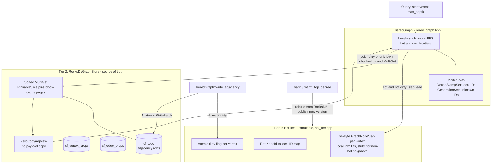

# low_latency_graphDB

A low-latency graph database implemented in C++.

The current core includes a bounded query arena, a cache-line-sized hot-node
slab, a bounds-checked adjacency view, and an in-memory breadth-first traversal
engine. `RocksDbGraphStore` (`rocksdb_graph_store.hpp`) provides the RocksDB
storage layer from design spec 03/04: column families `cf_topo`,
`cf_vertex_props`, `cf_edge_props`; big-endian keys; atomic `WriteBatch`
writes; snapshot reads; zero-copy adjacency via `ZeroCopyAdjView`; batched
`MultiGet` late materialization with a 10,000-key fan-out guard; and
`load_into(InMemoryGraph)` to warm the hot tier. `StorageBreadthFirstSearch`
(`storage_bfs.hpp`) traverses directly from RocksDB: level-synchronous, one
snapshot, with each level's adjacency rows fetched in sorted `MultiGet` chunks
whose block-cache pages stay pinned (`PinnableSlice`) only while that chunk is
consumed. `StorageBfsStats` reports pinned vs copied rows. `TieredGraph`
(`tiered_graph.hpp`) puts an immutable in-memory `HotTier` (`hot_tier.hpp`) in
front of RocksDB so hot traversals avoid per-hop RocksDB calls; see
[Architecture](#architecture).

## Architecture



- **Read path:** hot vertices are expanded from in-memory slabs; everything
  else is fetched from RocksDB in sorted, pinned `MultiGet` chunks and read in
  place through `ZeroCopyAdjView`.
- **Write path:** `TieredGraph::write_adjacency` commits to RocksDB first, then
  marks the hot copy dirty, so later queries read that vertex from RocksDB.
  Writes made directly on `RocksDbGraphStore` are not seen by the tier until it
  is rebuilt with `warm()` / `warm_top_degree()`. Vertex and edge properties
  are never cached in the tier.
- **Concurrency:** queries take no locks; each thread owns a `TieredBfsState`
  that caches the current tier and is refreshed only when the tier version
  changes.

## Requirements

- CMake 3.20 or newer
- A C++20-compatible compiler
- RocksDB: an installed `RocksDBConfig.cmake` is used if found; otherwise
  v9.7.4 is fetched and built from source. Configure with
  `-DLLG_ENABLE_ROCKSDB=OFF` to skip the storage layer.

## Build

```sh
cmake -S . -B build
cmake --build build
```

## Run

```sh
./build/low_latency_graphdb
```

The executable builds a small in-memory graph and runs a depth-limited BFS as
a smoke test. The traversal engine can currently be used with
`InMemoryGraph::add_edge` and `BreadthFirstSearch::run`.

## Latency benchmark

Correctness tests and performance tests have different purposes:

- `ctest` verifies traversal behavior and safety.
- `benchmark-cache-core` measures the cache-resident 64-byte hot path.
- The full BFS and hot-node benchmarks include query lifecycle overhead and
  are diagnostic workloads, not measurements of the cache-line target.

Build and run the deterministic parallel benchmark:

```sh
./build/low_latency_graphdb_latency_benchmark
```

Options include `--nodes`, `--degree`, `--queries`, `--depth`, and `--threads`.
The output reports p50, p95, p99, maximum, and mean per-query latency in
microseconds, plus aggregate queries per second.

For repeated access to one hot vertex, use:

```sh
./build/low_latency_graphdb_hot_node_benchmark \
  --degree 8 --queries 2000 --threads 4
```

This repeatedly runs a depth-1 query from vertex `0` after warming the graph,
and reports the same latency metrics.

To isolate the cache-resident 64-byte node scan itself:

```sh
./build/low_latency_graphdb_cache_core_benchmark 10000000 1
```

The first argument is scan iterations and the second is worker count. This
benchmark intentionally excludes graph lookup, query allocation, result
materialization, and thread scheduling inside each scan.

The same benchmark can be run through CMake:

```sh
cmake --build build --target benchmark-cache-core
```

For a real cache-resident BFS query with reusable queue and visited state:

```sh
./build/low_latency_graphdb_cache_resident_bfs_benchmark 1000 1 2 10000000 64
```

Arguments are `iterations`, `threads`, optional `depth`, optional node count,
optional queries-per-sample, and optional hot-node count. Set `iterations` to `0` to select the
depth-aware default. Each latency sample times that many identical
requests and divides by the batch size to avoid timer-resolution distortion.
When omitted, shallow cases use more samples and a batch of 64: depth 1 uses
1,000,000 iterations, depth 2 uses 200,000, depth 5 uses 20,000, and depth 7
uses 100. These defaults target roughly one second of query work per thread;
the depth-7 five-thread case remains within the 3-second run-time budget.
The standard comparison uses 1 thread and 5 threads; higher thread counts are
not representative of the target workload on this machine.

```sh
./build/low_latency_graphdb_cache_resident_bfs_benchmark 1000 5 2 10000000 64
```

```sh
./build/low_latency_graphdb_cache_resident_bfs_benchmark 1000 1 3 10000000 64
```

The canonical graph is now 10,000,000 nodes (640 MiB of slabs) with unique
tree children and fanout 8. Depths 5 and 7 are included to sweep from
approximately 2.4 MiB to 146 MiB of active node data; depth 7 requires at
least 2,396,745 reachable nodes. Reusable generation-stamped query state is
allocated according to the selected depth. Latency samples use `steady_clock`
around batches of identical requests to avoid timer-resolution distortion;
aggregate wall-time throughput is reported separately.

For the cache-size sweep:

```sh
./build/low_latency_graphdb_cache_resident_bfs_benchmark 10 1 5 10000000 1
./build/low_latency_graphdb_cache_resident_bfs_benchmark 10 1 7 10000000 1
```

For the depth-2 hot-node sweep, the final argument selects the number of
starting nodes used in a reproducible pseudo-random pattern:

```sh
./build/low_latency_graphdb_cache_resident_bfs_benchmark 0 1 2 10000000 64 10
./build/low_latency_graphdb_cache_resident_bfs_benchmark 0 1 2 10000000 64 100
./build/low_latency_graphdb_cache_resident_bfs_benchmark 0 1 2 10000000 64 10000
```

## RocksDB BFS benchmark

```sh
./build/low_latency_graphdb_rocksdb_bfs_benchmark \
  --nodes 200000 --fanout 8 --depth 3 --threads 1,4,8 --queries 2000
```

Builds a deterministic tree, bulk-loads and reopens RocksDB (cold cache), warms
the block cache, then reports per-query p50/p95/p99/max/mean, aggregate QPS,
visited vertices per query, and the share of adjacency rows served from pinned
cache pages. It also reports a `tiered` row (hot tier over RocksDB). Options:
`--pin-batch`, `--cache-mb`, `--path`, `--keep`, `--no-baseline`,
`--hot-tier K` (vertex IDs `[0, K)`, default nodes/20), `--hot-pct P` (share of
starts whose neighborhood is hot), `--hot-nodes N` (draw starts from `[0, N)`),
`--batch B` (queries per timed sample; latency is reported per query in ns) and
`--collect` (materialize visited IDs). The in-memory baseline allocates per-query arrays sized to the
whole graph, so it scales poorly with node count and is not a tuned reference.

## Test

```sh
ctest --test-dir build --output-on-failure
```
