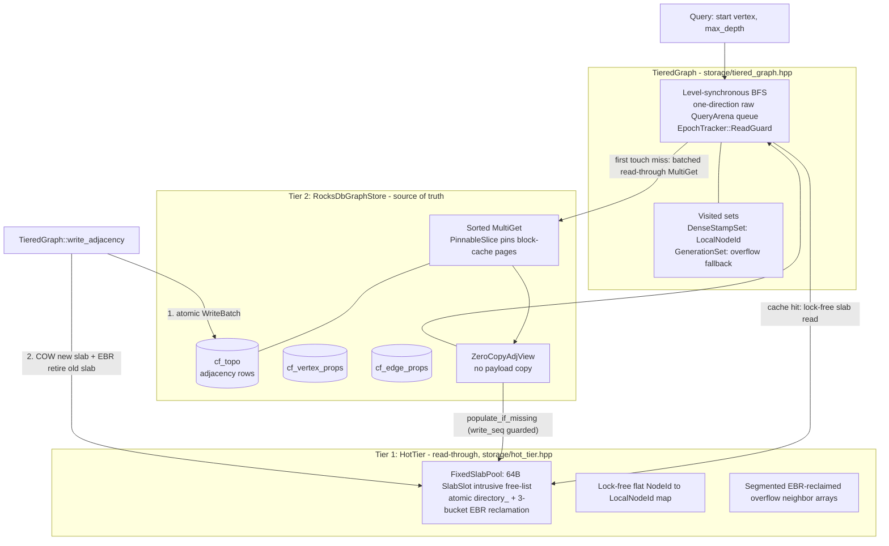

# low_latency_graphDB

A low-latency graph database engine implemented in C++20, designed from first hardware principles for high-concurrency, multi-hop graph traversal (BFS) workloads such as real-time lineage analysis, access control, and dependency tracking.

The core is built around four hardware-aware primitives — a per-query single-chunk linear arena (`QueryArena`), a 64-byte cache-line-aligned slab pool with EBR deferred reclamation (`GraphNodeSlab` / `FixedSlabPool` / `EpochTracker`), a zero-copy adjacency view (`ZeroCopyAdjView`), and topology-property physical separation — layered over a RocksDB storage backend with an on-demand, read-through `HotTier` and `TieredGraph` traversal engine.

---

## Architecture



**Read path (always on-demand, no `warm()` step).** Queries enter an `EpochTracker::ReadGuard` once and expand cached vertices lock-free from `FixedSlabPool` using a single one-direction raw `QueryArena` frontier queue. Any vertex not yet loaded is fetched in sorted, pinned RocksDB `MultiGet` chunks, decoded in place through `ZeroCopyAdjView`, and populated into `FixedSlabPool` (`write_seq_`-guarded against concurrent writes) so subsequent queries hit 100% in memory.

**Write path.** `TieredGraph::write_adjacency` commits atomically to RocksDB first (`WriteBatch`), then performs a live copy-on-write update in `HotTier`: allocates a fresh 64-byte slab from `FixedSlabPool`, atomically exchanges the directory pointer, and retires the old slab (and any overflow edge array) via 3-bucket EBR (`EpochTracker`). Updated hot vertices stay hot immediately with no dirty invalidation or tier rebuild.

**Concurrency.** Hot reads take no locks. Reader threads hold cache-line-isolated `alignas(64)` epoch slots in `EpochTracker` and per-thread `TieredBfsState` (reusable `DenseStampSet` + 16 MiB `QueryArena`).

---

## Core Design Primitives

### 1 — Query-Scoped Linear Arena (`QueryArena`)

Each worker thread owns a single pre-faulted, 64-byte aligned **16 MiB** chunk (`posix_memalign` + 4 KiB page touch). The chunk capacity is also the hard per-query byte quota: exceeding it throws `STATUS_QUERY_MEMORY_LIMIT_EXCEEDED` instead of growing. `TieredGraph::run` claims the arena directly as a **one-direction raw `LocalNodeId` queue** (no `std::vector` reallocation paths on the hot loop) and resets the cursor to zero in O(1) via `ArenaScope` (including on exceptions). Debug builds poison the buffer with `0xCD` on reset.

> **Why it matters.** Eliminates per-query `malloc`/`free`, heap fragmentation, global allocator lock contention, minor page faults, and `std::vector::push_back` slow-path code bloat inside tight traversal loops.

### 2 — 64-Byte Cache-Line-Aligned Slab & EBR Pool (`GraphNodeSlab` / `FixedSlabPool` / `EpochTracker`)

Every hot vertex occupies one 64-byte cache line (`alignas(64)`, `sizeof == 64` verified by `static_assert`):

- `NodeId` (8 B) — global 64-bit vertex ID
- `count` + `flags` (8 B) — degree and loaded status
- `inline_neighbors[11]` (44 B) — up to 11 local `u32` neighbor IDs, covering ≥92% of vertices in power-law graphs with no pointer indirection
- `overflow_index` (4 B) — index into a segmented, EBR-reclaimed overflow neighbor table for high-degree vertices

`FixedSlabPool` allocates a contiguous 64-byte aligned array of `union alignas(64) SlabSlot` (0-byte per-slot metadata: free slots store `next_free` in their first 8 bytes) with 4 KiB pre-faulting and 3-bucket EBR deferred reclamation (`retire_slot` / `reclaim_epoch`), coordinated by lock-free `EpochTracker` reader slots.

> **Why it matters.** One L1 cache-line fetch delivers the entire node with zero pointer chasing, zero cache-line splitting, zero false sharing, and safe lock-free concurrent updates without rebuilding the hot tier.

### 3 — Zero-Copy Adjacency View (`ZeroCopyAdjView`)

Decodes the binary adjacency wire format (`[count:4B | targets[n]:8B each | EdgeLightMeta[n]:8B each]`) stored in `cf_topo` without copying the payload. When the `PinnableSlice` buffer is naturally aligned, `targets()` and `edge_metas()` return zero-overhead `std::span` views directly into the pinned block-cache page. On unaligned buffers, per-element `memcpy` loads compile to a single unaligned load instruction on x86-64 and ARM64 with no UB.

### 4 — Topology-Property Physical Separation

Three RocksDB column families enforce strict separation between traversal-critical topology and query-final properties:

| Column family | Contents | Block cache | Compression | Access pattern |
|---|---|---|---|---|
| `cf_topo` | Adjacency rows (topology only) | 256 MiB (default) | None | First-touch read-through & persistence |
| `cf_vertex_props` | Per-vertex descriptive payload | 16 MiB (default) | Best available | Late materialization only |
| `cf_edge_props` | Per-edge heavy payload | 16 MiB (default) | Best available | Late materialization only |

Keys are encoded in **big-endian** so RocksDB's bytewise comparator orders them numerically, keeping sorted `MultiGet` batches in physical SST order. A 10,000-key fan-out guard bounds late materialization batches.

---

## Performance

All measurements taken on **Apple M5, 10 hardware threads, 16 GiB RAM** (Release `-O2 -DNDEBUG`).

### Case 04 — On-Demand Read-Through `FixedSlabPool` + One-Direction `QueryArena` (No `warm()`)

1 M nodes, fanout 8, RocksDB v9.7.4; compared against the previous immutable pre-warmed `HotTier` baseline (~0.44 s upfront `warm()`). See [read_through_slab_pool_case_04.md](tests/read_through_slab_pool_case_04.md) for full details.

**Depth sweep (p50; 1T starts cold and loads on demand, 5T runs in steady state):**

| Depth | Threads | Prev. Baseline (pre-warmed) | Read-through `FixedSlabPool` (no `warm()`) | `hot_rows` | vs. Baseline |
|------:|--------:|----------------------------:|-------------------------------------------:|-----------:|-------------:|
| 1 | 1T | 13 ns | **12 ns** | 99.8% | **-8%** |
| 1 | 5T | 18 ns | **19 ns** *(75.3M QPS)* | 100.0% | ~same |
| 2 | 1T | 66 ns | **52 ns** | 99.8% | **-21%** |
| 2 | 5T | 99 ns | **73 ns** *(37.5M QPS)* | 100.0% | **-26%** |
| 5 | 1T | 28.1 µs | **21.3 µs** | 94.1% | **-24%** |
| 5 | 5T | 33.9 µs | **24.5 µs** *(126k QPS)* | 100.0% | **-28%** |
| 6 | 1T | 206 µs | **153.5 µs** | 99.4% | **-25%** |
| 6 | 5T | 240 µs | **177.9 µs** *(24k QPS)* | 100.0% | **-26%** |

**Random-start workloads (depth 2, 40,000 queries/thread, steady state vs. pre-warmed baseline):**

| Workload | Variant | Threads | p50 | p99 | QPS | vs. Baseline p50 |
|---|---|---:|---:|---:|---:|---:|
| 10,000 random hot starts (`--hot-nodes 10000`) | RocksDB only | 1T / 5T | 3,924 / 5,850 ns | 4,266 / 13,530 ns | 0.25M / 0.75M | — |
| 10,000 random hot starts (`--hot-nodes 10000`) | Baseline *(pre-warmed)* | 1T / 5T | 97 / 115 ns | 261 / 306 ns | 8.07M / 27.5M | — |
| 10,000 random hot starts (`--hot-nodes 10000`) | **New *(read-through steady)*** | **1T / 5T** | **85 / 117 ns** | **145 / 419 ns** | **10.7M / 22.9M** | **-12% / ~same** |
| 100% uniform random all 125k internal (`--hot-pct 0`) | RocksDB only | 1T / 5T | 4,225 / 5,913 ns | 4,657 / 14,038 ns | 0.24M / 0.74M | — |
| 100% uniform random all 125k internal (`--hot-pct 0`) | Baseline *(pre-warmed)* | 1T / 5T | 245 / 249 ns | 304 / 397 ns | 3.89M / 14.2M | — |
| 100% uniform random all 125k internal (`--hot-pct 0`) | **New *(read-through steady)*** | **1T / 5T** | **125 / 227 ns** | **182 / 482 ns** | **7.69M / 15.7M** | **-49% / -9%** |

### Case 01 — Cache-Resident BFS Depth Sweep (10 M nodes)

10 M nodes, 640 MiB of slabs, fanout 8, start node 0. See [cache_resident_bfs_depth_sweep_case_01.md](tests/cache_resident_bfs_depth_sweep_case_01.md).

| Depth | Threads | Nodes visited | p50 ns | p95 ns | p99 ns | p50 ns/node |
|------:|--------:|--------------:|-------:|-------:|-------:|------------:|
| 1 | 1 | 9 | 7 | 7 | 8 | 0.78 |
| 1 | 5 | 9 | 7 | 21 | 53 | 0.78 |
| 2 | 1 | 73 | 52 | 54 | 54 | 0.71 |
| 2 | 5 | 73 | 62 | 158 | 234 | 0.85 |
| 5 | 1 | 37,449 | 37,000 | 37,958 | 43,084 | 0.99 |
| 7 | 1 | 2,396,745 | 10,284,541 | 13,643,375 | 14,531,167 | 4.29 |

### Case 02 — Depth-2 Hot-Node Count Sweep (10 M nodes)

10 M nodes, fanout 8, depth 2 (73 nodes visited), random starts drawn from the hot set. See [cache_resident_bfs_hot_nodes_case_02.md](tests/cache_resident_bfs_hot_nodes_case_02.md).

| Hot nodes | Threads | p50 ns | p95 ns | p99 ns |
|----------:|--------:|-------:|-------:|-------:|
| 10 | 1 | 58 | 61 | 69 |
| 100 | 1 | 58 | 60 | 61 |
| 10,000 | 1 | 69 | 72 | 75 |
| 10 | 5 | 68 | 147 | 225 |
| 10,000 | 5 | 89 | 178 | 292 |

### Case 03 — RocksDB BFS vs. Hot Tier (10 M nodes)

10 M nodes, fanout 8; `rocksdb` = `StorageBreadthFirstSearch` (100% cache-pinned rows) vs. `TieredGraph` hot tier. See [rocksdb_bfs_case_03.md](tests/rocksdb_bfs_case_03.md).

| Depth | Threads | rocksdb p50 | tiered p50 | Speedup |
|------:|--------:|------------:|-----------:|--------:|
| 1 | 1T | 589 ns | **13 ns** | **~45×** |
| 2 | 1T | 3,096 ns | **54 ns** | **~57×** |
| 5 | 1T | 1.98 ms | **28.8 µs** | **~69×** |
| 7 | 1T | 125.2 ms | **1.65 ms** | **~76×** |

> All latency figures are wall-clock measurements via `std::chrono::steady_clock`, not hardware-counter results.

---

## Requirements

- CMake 3.20 or newer
- A C++20-compatible compiler (GCC 12+, Clang 15+, Apple Clang 15+)
- **RocksDB** (storage layer): an installed `RocksDBConfig.cmake` is used if found; otherwise RocksDB v9.7.4 is fetched and built from source automatically. Pass `-DLLG_ENABLE_ROCKSDB=OFF` to skip the storage layer and build only the in-memory core.

---

## Build

```sh
cmake -S . -B build -DCMAKE_BUILD_TYPE=Release
cmake --build build
```

To disable the RocksDB storage layer:

```sh
cmake -S . -B build -DLLG_ENABLE_ROCKSDB=OFF
cmake --build build
```

---

## Run

```sh
./build/low_latency_graphdb [optional_db_path]
```

Opens a `RocksDbGraphStore` fronted by `TieredGraph` (read-through `FixedSlabPool` + EBR + per-thread `QueryArena`), writes a small graph, runs a read-through BFS, a cached hot BFS, a live COW update, and late-materialized property lookup (cleaning up its temporary DB when no path is given).

---

## Tests

```sh
ctest --test-dir build --output-on-failure
```

Three test suites are registered with CTest:

| Suite | Binary | What it checks |
|---|---|---|
| `core` | `low_latency_graphdb_core_tests` | `QueryArena` (64B align, hard quota, `ArenaScope`, `ArenaAllocator`), `FixedSlabPool` (`SlabSlot` free-list, 3-bucket EBR retire/reclaim, concurrent `EpochTracker` stress), `ZeroCopyAdjView`, `InMemoryGraph`, `BreadthFirstSearch` |
| `hot_node_correctness` | `low_latency_graphdb_hot_node_correctness_test` | Hot-node traversal correctness across multiple hot-set sizes |
| `rocksdb_store` | `low_latency_graphdb_rocksdb_tests` | `RocksDbGraphStore`, `StorageBreadthFirstSearch`, `TieredGraph` read-through loading, live COW + EBR updates, small-pool fallback, concurrent readers/writers, and arena quota enforcement |

---

## Benchmarks

### Cache-core scan benchmark

Measures raw 64-byte slab scan throughput, excluding graph lookup, query allocation, result materialization, and thread scheduling.

```sh
./build/low_latency_graphdb_cache_core_benchmark 10000000 1
# or via CMake:
cmake --build build --target benchmark-cache-core
```

### Cache-resident BFS benchmark

Measures in-memory BFS latency with reusable queue and visited state on a 10 M-node tree (fanout 8).

```sh
./build/low_latency_graphdb_cache_resident_bfs_benchmark 0 1 2 10000000 64
./build/low_latency_graphdb_cache_resident_bfs_benchmark 0 5 2 10000000 64
./build/low_latency_graphdb_cache_resident_bfs_benchmark 0 1 2 10000000 64 10000
```

**Arguments:** `<iterations> <threads> [depth] [node_count] [queries_per_sample] [hot_node_count]` (`iterations=0` selects depth-aware defaults).

### Hot-node & full-graph latency benchmarks

```sh
./build/low_latency_graphdb_hot_node_benchmark --degree 8 --queries 2000 --threads 4
./build/low_latency_graphdb_latency_benchmark --nodes 100000 --degree 8 --queries 1000 --depth 3 --threads 4
```

### RocksDB & Read-Through Tiered BFS benchmark

Builds a deterministic tree, bulk-loads and reopens RocksDB, warms the RocksDB block cache, then benchmarks `StorageBreadthFirstSearch` and read-through `TieredGraph` side by side (no upfront `warm()`).

```sh
./build/low_latency_graphdb_rocksdb_bfs_benchmark \
  --nodes 1000000 --fanout 8 --depth 2 --threads 1,5 --queries 40000 --batch 64 --hot-nodes 10000 --no-baseline
```

**Key options:**

| Flag | Default | Description |
|---|---|---|
| `--nodes N` | 200000 | Total vertices |
| `--fanout F` | 8 | Tree out-degree |
| `--depth D` | 3 | BFS depth |
| `--threads T` | 1 | Comma-separated thread counts (can repeat, e.g. `1,5,1`) |
| `--queries Q` | 2000 | Queries per thread count |
| `--batch B` | 1 | Queries per timed sample; latency reported per query in ns |
| `--hot-tier K` | `nodes` | `FixedSlabPool` vertex capacity (`0` disables tiered run) |
| `--hot-pct P` | 90 | % of query starts drawn from the hot region (`0` = 100% uniform random) |
| `--hot-nodes N` | 0 | Draw starts uniformly from `[0, N)` when non-zero |
| `--pin-batch B` | 1024 | Rows pinned simultaneously per `MultiGet` chunk |
| `--cache-mb M` | 256 | Topology block-cache size (MiB) |
| `--path P` | tmp dir | RocksDB data directory |
| `--keep` | false | Keep the RocksDB directory after the run |
| `--no-baseline` | false | Skip the pure in-memory BFS baseline |
| `--collect` | false | Materialize visited IDs (instead of count-only) |

---

## Project Layout

```
low_latency_graphDB/
├── include/low_latency_graphdb/
│   ├── query_arena.hpp               # Core: single-chunk 16 MiB bump arena, ArenaScope, ArenaAllocator
│   ├── graph_node_slab.hpp           # Core: 64B GraphNodeSlab, SlabSlot free-list, FixedSlabPool + EBR EpochTracker
│   ├── generation_set.hpp            # Core: O(1)-clear GenerationSet & DenseStampSet
│   ├── adjacency_view.hpp            # Core: zero-copy adjacency decoder (ZeroCopyAdjView)
│   ├── storage/                      # RocksDB integration & tiered engine
│   │   ├── storage_codec.hpp         # Big-endian key/value codec for RocksDB
│   │   ├── rocksdb_graph_store.hpp   # RocksDB store: 3 column families, PinnableSlice MultiGet
│   │   ├── storage_bfs.hpp           # Level-synchronous BFS over RocksDB
│   │   ├── hot_tier.hpp              # Live read-through HotTier backed by FixedSlabPool + EBR
│   │   └── tiered_graph.hpp          # TieredGraph: one-direction QueryArena BFS + read-through + COW writes
│   └── testing/                      # Reference / test-only in-memory graph & oracle BFS
│       ├── in_memory_graph.hpp       # InMemoryGraph (test oracle & baseline)
│       └── breadth_first_search.hpp  # Arena-backed BFS over InMemoryGraph
├── src/
│   └── main.cpp                  # Smoke-test entry point
├── benchmarks/
│   ├── cache_core_benchmark.cpp
│   ├── cache_resident_bfs_benchmark.cpp
│   ├── hot_node_benchmark.cpp
│   ├── latency_benchmark.cpp
│   └── rocksdb_bfs_benchmark.cpp
├── tests/
│   ├── core_tests.cpp
│   ├── hot_node_correctness.cpp
│   ├── rocksdb_store_tests.cpp
│   ├── cache_resident_bfs_depth_sweep_case_01.md
│   ├── cache_resident_bfs_hot_nodes_case_02.md
│   ├── rocksdb_bfs_case_03.md
│   └── read_through_slab_pool_case_04.md           # Benchmark report: read-through FixedSlabPool + EBR
└── CMakeLists.txt
```

---

## Design Documentation

The `01`–`04` markdown files at the repository root contain deep-dive design specifications (written in Chinese) tracing each primitive to its hardware-physical motivation:

| File | Topic |
|---|---|
| `01 - 查询级线性内存池…` | QueryArena — single-chunk 16 MiB pre-faulted bump arena, quota isolation, O(1) reset |
| `02 - 64字节缓存行对齐节点…` | GraphNodeSlab & FixedSlabPool — 64B cache-line alignment, intrusive free-list, 3-bucket EBR |
| `03 - 零拷贝存储页视图解码器…` | ZeroCopyAdjView — memcpy overhead, cache pollution, `PinnableSlice` safety |
| `04 - 拓扑与属性物理分离…` | Topology-Property Separation — cache-line pollution, read amplification, late materialization |

A roadmap index covering planned future phases (RocksDB prefix Bloom filters, compaction I/O isolation, lock-free SPSC queues, and an append-only partitioned message queue) is tracked in `00 - 总览索引…`.
