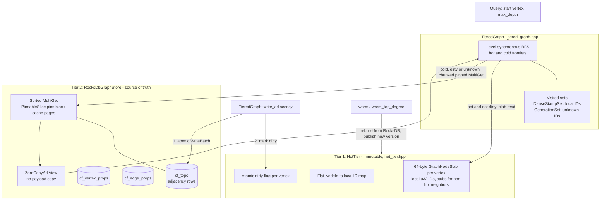

# low_latency_graphDB

A low-latency graph database engine implemented in C++20, designed from first hardware principles for high-concurrency, multi-hop graph traversal (BFS) workloads such as real-time lineage analysis, access control, and dependency tracking.

The core is built around four hardware-aware primitives — a per-query linear arena (`QueryArena`), a cache-line-sized hot-node slab (`GraphNodeSlab`), a zero-copy adjacency view (`ZeroCopyAdjView`), and topology-property physical separation — layered over a RocksDB storage backend with an in-memory hot tier (`HotTier`) and a two-tier hybrid traversal engine (`TieredGraph`).

---

## Architecture



**Read path.** Hot vertices are expanded directly from in-memory 64-byte slabs (Tier 1); everything else is fetched from RocksDB in sorted, pinned `MultiGet` chunks and decoded in place through `ZeroCopyAdjView` without copying the payload.

**Write path.** `TieredGraph::write_adjacency` commits to RocksDB first (atomic `WriteBatch`), then atomically marks the hot-tier copy dirty. Subsequent queries for that vertex fall through to RocksDB until the tier is rebuilt with `warm()` / `warm_top_degree()`. Writes made directly on `RocksDbGraphStore` are not reflected in the tier until it is rebuilt.

**Concurrency.** Queries take no locks during traversal. Each querying thread owns a `TieredBfsState` that caches its current tier pointer and refreshes it atomically only when the graph publishes a new tier version.

---

## Core Design Primitives

### 1 — Query-Scoped Linear Arena (`QueryArena`)

Each query allocates all temporary state (visited bitset, BFS queues, path buffers) from a bump-pointer arena backed by a single 4 MiB primary slab. At query teardown the arena is reset in O(1) — no per-object `free()` calls, no heap fragmentation. A configurable hard quota (default 16 MiB) aborts a runaway query before it can exhaust process memory.

> **Why it matters.** On a 64-core server, concurrent queries thrash the global `malloc` arena and generate heap fragmentation that cannot be reclaimed because long-lived objects share physical pages with short-lived query temporaries, causing RSS to balloon until OOM.

### 2 — 64-Byte Cache-Line-Aligned Node Slab (`GraphNodeSlab`)

Every vertex in the hot tier occupies exactly one 64-byte cache line (`alignas(64)`, `sizeof == 64` verified by `static_assert`). The slab stores:

- `NodeId` (8 B) — global 64-bit vertex ID
- `count` + `flags` (8 B) — degree and hot/dirty status
- `inline_neighbors[11]` (44 B) — up to 11 local `u32` neighbor IDs, covering ≥92% of vertices in power-law graphs with no pointer indirection
- `overflow_index` (4 B) — index into a contiguous overflow array for high-degree vertices

> **Why it matters.** A single L1 cache-line fetch delivers the entire node. No pointer chasing, no cache-line splitting, no false sharing between adjacent nodes on different cores.

### 3 — Zero-Copy Adjacency View (`ZeroCopyAdjView`)

Decodes the binary adjacency wire format (`[count:4B | targets[n]:8B each | EdgeLightMeta[n]:8B each]`) stored in `cf_topo` without copying the payload. When the `PinnableSlice` buffer is naturally aligned, `targets()` and `edge_metas()` return zero-overhead `std::span` views directly into the pinned block-cache page. On unaligned buffers (rare in practice), per-element `memcpy` loads — compiled to a single `MOV` on x86-64 and ARM64 — provide safe unaligned access with no UB.

> **Why it matters.** Copying an adjacency row into a temporary `std::vector` wastes L1/L2 cache capacity and burns memory-bus bandwidth, the scarcest resource in a multi-hop traversal.

### 4 — Topology-Property Physical Separation

Three RocksDB column families enforce strict separation between traversal-critical topology and query-final properties:

| Column family | Contents | Block cache | Compression | Access pattern |
|---|---|---|---|---|
| `cf_topo` | Adjacency rows (topology only) | 256 MiB (default) | None | Every hop — hot path |
| `cf_vertex_props` | Per-vertex descriptive payload | 16 MiB (default) | Best available | Late materialization only |
| `cf_edge_props` | Per-edge heavy payload | 16 MiB (default) | Best available | Late materialization only |

Keys are encoded in **big-endian** so RocksDB's default bytewise comparator sorts them in numeric ID order, keeping sorted `MultiGet` batches in physical SST order and maximising block-cache hit rates.

A 10,000-key fan-out guard on `MultiGet` materialization prevents pathological queries from accidentally loading millions of attribute records.

---

## Performance

All measurements taken on **Apple M5, 10 hardware threads, 16 GiB RAM**.

### Case 01 — Cache-Resident BFS Depth Sweep

10 M nodes, 640 MiB of slabs, fanout 8, start node 0.

| Depth | Threads | Nodes visited | p50 ns | p95 ns | p99 ns | p50 ns/node |
|------:|--------:|--------------:|-------:|-------:|-------:|------------:|
| 1 | 1 | 9 | 7 | 7 | 8 | 0.78 |
| 1 | 5 | 9 | 7 | 21 | 53 | 0.78 |
| 2 | 1 | 73 | 52 | 54 | 54 | 0.71 |
| 2 | 5 | 73 | 62 | 158 | 234 | 0.85 |
| 5 | 1 | 37,449 | 37,000 | 37,958 | 43,084 | 0.99 |
| 7 | 1 | 2,396,745 | 10,284,541 | 13,643,375 | 14,531,167 | 4.29 |

Depths 1 and 2 fit comfortably in L1/L2. Depth 5 (≈2.4 MiB active data) stays near 1 ns/node thanks to sequential slab layout and hardware prefetching. Depth 7 (≈146 MiB) shows increased tail latency consistent with shared L3 pressure.

### Case 02 — Depth-2 Hot-Node Count Sweep

10 M nodes, fanout 8, depth 2 (73 nodes visited), random starts drawn from the hot set.

| Hot nodes | Threads | p50 ns | p95 ns | p99 ns |
|----------:|--------:|-------:|-------:|-------:|
| 10 | 1 | 58 | 61 | 69 |
| 100 | 1 | 58 | 60 | 61 |
| 10,000 | 1 | 69 | 72 | 75 |
| 10 | 5 | 68 | 147 | 225 |
| 10,000 | 5 | 89 | 178 | 292 |

Expanding the hot-node working set from 10 to 10,000 adds only ≈11 ns to the single-thread p50, confirming that the slab layout and arena allocation remain cache-resident.

### Case 03 — RocksDB BFS vs HotTier (Tiered)

10 M nodes, fanout 8; `rocksdb` = `StorageBreadthFirstSearch` (sorted pinned `MultiGet`, `ZeroCopyAdjView`, 100% cache-pinned rows); `tiered` = `TieredGraph` (100% hot-tier rows served from memory slabs). Count-only output.

**Depths 1–2 (p50 ns, hot-node count sweep):**

| Depth | Hot nodes | rocksdb 1T | tiered 1T | rocksdb 5T | tiered 5T |
|------:|----------:|-----------:|----------:|-----------:|----------:|
| 1 | 1 | 589 | **13** | 3,563 | **19** |
| 1 | 10,000 | 755 | **20** | 3,086 | **26** |
| 2 | 1 | 3,096 | **54** | 9,462 | **78** |
| 2 | 10,000 | 4,700 | **89** | 6,286 | **124** |

**Depths 5–7 (random hot starts, p50):**

| Depth | Threads | rocksdb | tiered | Speedup |
|------:|--------:|--------:|-------:|--------:|
| 5 | 1 | 1.98 ms | 28.8 µs | **~69×** |
| 5 | 5 | 2.36 ms | 34.3 µs | **~69×** |
| 7 | 1 | 125.2 ms | 1.65 ms | **~76×** |
| 7 | 5 | 165.8 ms | 2.04 ms | **~81×** |

Hot-tier memory footprint: 752 MiB (1 M hot + 7 M stub slabs) for depths 1–2; 1.1 GiB (2.5 M hot + 7.5 M stubs) for depths 5–7. Tier build time: 0.7–1.7 s.

> All latency figures are wall-clock measurements via `std::chrono::steady_clock`, not hardware-counter results.

---

## Requirements

- CMake 3.20 or newer
- A C++20-compatible compiler (GCC 12+, Clang 15+, Apple Clang 15+)
- **RocksDB** (storage layer): an installed `RocksDBConfig.cmake` is used if found; otherwise RocksDB v9.7.4 is fetched and built from source automatically. Pass `-DLLG_ENABLE_ROCKSDB=OFF` to skip the storage layer entirely and build only the in-memory core.

---

## Build

```sh
cmake -S . -B build
cmake --build build
```

To disable the RocksDB storage layer:

```sh
cmake -S . -B build -DLLG_ENABLE_ROCKSDB=OFF
cmake --build build
```

---

## Run

```sh
./build/low_latency_graphdb
```

The main executable builds a small in-memory graph and runs a depth-2 BFS as a smoke test, printing the arena quota, hot-node pool capacity, and visited node count.

---

## Tests

```sh
ctest --test-dir build --output-on-failure
```

Three test suites are registered with CTest:

| Suite | Binary | What it checks |
|---|---|---|
| `core` | `low_latency_graphdb_core_tests` | `QueryArena`, `GraphNodeSlab`, `ZeroCopyAdjView`, `InMemoryGraph`, `BreadthFirstSearch`, `GenerationSet` |
| `hot_node_correctness` | `low_latency_graphdb_hot_node_correctness_test` | `TieredGraph` / `HotTier` traversal correctness at multiple depths and hot-node set sizes |
| `rocksdb_store` | `low_latency_graphdb_rocksdb_tests` | `RocksDbGraphStore` write/read/batch, `StorageBreadthFirstSearch`, snapshot isolation |

---

## Benchmarks

Correctness tests and performance benchmarks have distinct purposes:

- `ctest` verifies traversal correctness and safety guarantees.
- The benchmarks below measure specific latency targets on the hot path.

### Cache-core scan benchmark

Measures the raw 64-byte slab scan throughput, excluding graph lookup, query allocation, result materialization, and thread scheduling.

```sh
./build/low_latency_graphdb_cache_core_benchmark 10000000 1
```

Arguments: `<iterations> <worker_count>`. Can also be run via CMake:

```sh
cmake --build build --target benchmark-cache-core
```

### Cache-resident BFS benchmark

Measures full BFS latency with reusable queue and visited state on a purely in-memory graph. Reports p50, p95, p99, max, and mean per-query latency in nanoseconds.

```sh
# Depth-aware defaults (~1 s of work per thread):
./build/low_latency_graphdb_cache_resident_bfs_benchmark 0 1 2 10000000 64

# Five threads, depth 2:
./build/low_latency_graphdb_cache_resident_bfs_benchmark 0 5 2 10000000 64

# Depth-5 and depth-7 cache-size sweep (1 query/sample):
./build/low_latency_graphdb_cache_resident_bfs_benchmark 10 1 5 10000000 1
./build/low_latency_graphdb_cache_resident_bfs_benchmark 10 1 7 10000000 1

# Depth-2 hot-node sweep:
./build/low_latency_graphdb_cache_resident_bfs_benchmark 0 1 2 10000000 64 10
./build/low_latency_graphdb_cache_resident_bfs_benchmark 0 1 2 10000000 64 100
./build/low_latency_graphdb_cache_resident_bfs_benchmark 0 1 2 10000000 64 10000
```

**Arguments:** `<iterations> <threads> [depth] [node_count] [queries_per_sample] [hot_node_count]`

Set `iterations=0` to select the depth-aware default (depth 1: 1 M, depth 2: 200 k, depth 5: 20 k, depth 7: 100). Each latency sample times `queries_per_sample` identical requests and divides by the batch size to avoid timer-resolution distortion.

The canonical graph is 10,000,000 nodes (640 MiB of slabs) with a unique-child tree topology and fanout 8.

### Hot-node benchmark

Repeatedly runs a depth-1 query from vertex 0 after warming the graph, to isolate repeated hot-path access latency.

```sh
./build/low_latency_graphdb_hot_node_benchmark --degree 8 --queries 2000 --threads 4
```

### Full-graph latency benchmark

Multi-threaded BFS latency across a randomly generated graph. Reports p50, p95, p99, max, mean per-query latency (µs), and aggregate QPS.

```sh
./build/low_latency_graphdb_latency_benchmark --nodes 100000 --degree 8 --queries 1000 --depth 3 --threads 4
```

Options: `--nodes`, `--degree`, `--queries`, `--depth`, `--threads`.

### RocksDB BFS benchmark

Builds a deterministic tree, bulk-loads and reopens RocksDB (cold block cache), warms the cache, then benchmarks `StorageBreadthFirstSearch` (baseline) and `TieredGraph` side by side. Reports per-query p50/p95/p99/max/mean (ns), aggregate QPS, visited-vertices count, and the share of adjacency rows served from pinned cache pages.

```sh
./build/low_latency_graphdb_rocksdb_bfs_benchmark \
  --nodes 200000 --fanout 8 --depth 3 --threads 1,4,8 --queries 2000
```

**Key options:**

| Flag | Default | Description |
|---|---|---|
| `--nodes N` | 200000 | Total vertices |
| `--fanout F` | 8 | Tree out-degree |
| `--depth D` | 3 | BFS depth |
| `--threads T` | 1 | Comma-separated thread counts |
| `--queries Q` | 2000 | Queries per thread count |
| `--batch B` | 1 | Queries per timed sample; latency reported per query in ns |
| `--hot-tier K` | nodes/20 | Vertex IDs `[0, K)` pre-loaded into HotTier |
| `--hot-pct P` | 0 | % of query starts drawn from the hot region |
| `--hot-nodes N` | — | Draw starts from `[0, N)` |
| `--pin-batch B` | 1024 | Rows pinned simultaneously per MultiGet chunk |
| `--cache-mb M` | 256 | Topology block-cache size (MiB) |
| `--path P` | tmp dir | RocksDB data directory |
| `--keep` | false | Keep the RocksDB directory after the run |
| `--no-baseline` | false | Skip the pure in-memory BFS baseline |
| `--collect` | false | Materialize visited IDs (instead of count-only) |

> The in-memory baseline allocates per-query arrays sized to the entire graph and does not represent a tuned reference implementation.

---

## Project Layout

```
low_latency_graphDB/
├── include/low_latency_graphdb/
│   ├── query_arena.hpp           # Per-query bump-pointer arena with hard quota
│   ├── graph_node_slab.hpp       # 64-byte aligned node slab + FixedSlabPool
│   ├── generation_set.hpp        # O(1)-clear open-addressing hash set (GenerationSet)
│   │                             # + dense stamp set for local IDs (DenseStampSet)
│   ├── adjacency_view.hpp        # Zero-copy adjacency decoder (ZeroCopyAdjView)
│   ├── storage_codec.hpp         # Big-endian key/value codec for RocksDB
│   ├── in_memory_graph.hpp       # Compact in-memory graph with GraphNodeSlab storage
│   ├── breadth_first_search.hpp  # Arena-backed BFS over InMemoryGraph
│   ├── rocksdb_graph_store.hpp   # RocksDB store: 3 column families, PinnableSlice MultiGet
│   ├── storage_bfs.hpp           # Level-synchronous BFS over RocksDB
│   ├── hot_tier.hpp              # Immutable in-memory hot tier (HotTier)
│   └── tiered_graph.hpp          # Two-tier hybrid traversal engine (TieredGraph)
├── src/
│   └── main.cpp                  # Smoke-test entry point
├── benchmarks/
│   ├── cache_core_benchmark.cpp
│   ├── cache_resident_bfs_benchmark.cpp
│   ├── hot_node_benchmark.cpp
│   ├── latency_benchmark.cpp
│   └── rocksdb_bfs_benchmark.cpp
├── tests/
│   ├── core_tests.cpp
│   ├── hot_node_correctness.cpp
│   ├── rocksdb_store_tests.cpp
│   ├── cache_resident_bfs_depth_sweep_case_01.md   # Benchmark report: depth sweep
│   ├── cache_resident_bfs_hot_nodes_case_02.md     # Benchmark report: hot-node sweep
│   └── rocksdb_bfs_case_03.md                      # Benchmark report: RocksDB vs HotTier
└── CMakeLists.txt
```

---

## Design Documentation

The `01`–`04` markdown files at the repository root contain deep-dive design specifications (written in Chinese) that trace each primitive to its hardware-physical motivation:

| File | Topic |
|---|---|
| `01 - 查询级线性内存池…` | QueryArena — heap fragmentation, lock contention, quota isolation |
| `02 - 64字节缓存行对齐节点…` | GraphNodeSlab — pointer chasing, cache-line splitting, false sharing |
| `03 - 零拷贝存储页视图解码器…` | ZeroCopyAdjView — memcpy overhead, cache pollution, dangling-pointer safety |
| `04 - 拓扑与属性物理分离…` | Topology-Property Separation — cache-line pollution, read amplification, late materialization |

A roadmap index covering planned future phases (RocksDB prefix Bloom filters, compaction I/O isolation, lock-free SPSC queues, and an append-only partitioned message queue) is tracked in `00 - 总览索引…`.
